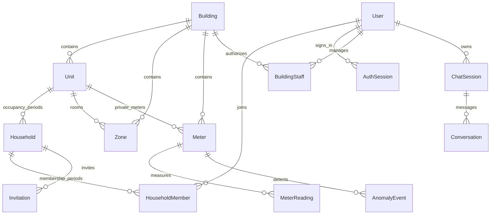

# Household accounts and data isolation

Implemented directly, continuing the user's authorization to bypass the blocked BMAD workflow.

## Assessment before migration

The existing PostgreSQL database had five business entities: Building, Zone, MeterReading, AnomalyEvent and Conversation. It had no user identity, household, membership or meter ownership model. Zone represented a physical room and could not safely be treated as an authenticated household. API keys protected machine/admin mutations, not resident identity. Legacy history, anomaly listing, replay tools and SSE therefore needed an authentication perimeter before residents could be introduced.

Preserved baseline: 2 buildings, 10 zones, 10,504 readings and 38 conversation rows. A pg_dump backup was created before changes at `_bmad-output/database-backups/ecotrack-pre-households-2026-11-02.sql`; this directory is Git-ignored.

## Data model



- User stores a normalized unique email, name, salted password hash and account status. Public registration never grants staff/platform roles.
- AuthSession stores a hash of a random 256-bit session token, user and expiry. The raw token is held in an HttpOnly, SameSite=Lax cookie, with Secure enabled in production. Logout deletes the current server-side session.
- Unit represents a physical apartment. Household represents a period of occupancy, keeping a new household separate from the previous occupants of that apartment.
- HouseholdMember records access periods and OWNER/MEMBER roles. One active period per user/household is enforced by a partial unique index; explicit re-invitation creates a new period instead of restoring old access.
- BuildingStaff grants MANAGER access only to named buildings. A local setup script provisions managers; there is no public self-promotion endpoint.
- Meter has explicit BUILDING_TOTAL, COMMON, UNIT or UNASSIGNED scope, plus a measurement interval. UNIT meters belong to an apartment; room associations are optional.
- Invitation is email-bound, expires after 48 hours, stores only a token hash, and is consumed atomically once. A household owner may invite MEMBER users; managers may also invite owners. Revocation expires pending invitations for the revoked account.
- ChatSession belongs to a user and a scope. Existing anonymous Conversation rows remain unassigned and cannot be recovered by resident chat routes.

Applied migrations:

1. `20261102090000_household_access`: adds account/household/meter/session tables, meter links and safe data backfill. Adds ownership validation triggers, scope/date checks and one open occupancy per apartment.
2. `20261102093000_membership_periods`: preserves old membership periods while preventing duplicate active membership.

All 10,504 existing readings remain present and have meter IDs. There are 12 meters: 2 building totals and 10 unassigned room meters. No apartment or household was guessed from the old rooms, and no historical chat was assigned to a user.

## Access policy

| Actor | Own household | Another household | Building total/common areas | Administration |
| --- | --- | --- | --- | --- |
| Anonymous | Denied | Denied | Denied | Denied |
| Registered, not invited | Denied | Denied | Denied | Denied |
| Current resident | Allowed during current membership/occupancy period | Denied unless separately a member | Allowed for their current building | Denied |
| Household owner | Same resident access | Same restriction | Same restriction | May invite members into their own household |
| Building manager | Allowed for the assigned building | Only within assigned building | Assigned building only | Create apartments/occupancies, assign unassigned meters, invite/revoke residents, end occupancy |
| Platform administrator | Explicit elevated access | Elevated access | Elevated access | Legacy unscoped APIs remain behind this role |

Ending occupancy or revoking membership removes resident access to that household, including historical endpoints and saved scoped chats. New occupants and re-invited members receive no private readings or chats from before their new access period. Shared building views expose total/common meters, not the individual apartment breakdown.

## Enforcement

Every portal request resolves the server-side session and checks current membership/staff scope. Caller-supplied building and household IDs select a requested scope; they do not grant permission. Queries use authorized meter IDs and an authorized timestamp window. The browser's dropdown is not a security control.

Legacy global analytics, building lists, SSE and Copilot endpoints require a platform administrator session. A machine API key does not bypass resident access controls. Sensor ingestion retains its independent machine key and computes the meter association server-side.

Portal SSE rechecks the session and membership on every event and heartbeat, filters by authorized meter and timestamp, and closes on revocation/expiry. It never accepts a default unfiltered resident stream.

Portal responses are no-store. Credentialed CORS allows configured frontend origins only, and mutation requests from other browser origins are rejected. Passwords use the asynchronous Node scrypt KDF with a unique salt; login/registration have a bounded per-IP rate limiter.

Database constraints protect meter scope/ownership and active occupancy/membership rules. SQL-only checks, partial indexes and triggers are deployed through migrations; Prisma db push is not a substitute for these migrations. PostgreSQL RLS was not introduced in this iteration.

## User interface and demo setup

The application entry opens the resident portal with login/registration, invitation acceptance, a scope selector, authorized readings/room cards, history and scoped assistant summaries. Managers also receive apartment creation, explicit room assignment, common-area publication, invitations, membership revocation and occupancy rollover controls.

A manager for `office_tower_01` has been provisioned. Its generated credentials are in `backend/.demo-manager.key`, which is Git-ignored. The account has building-manager access, not platform-administrator access. The password is not included in this report.

To demonstrate:

1. Start/restart the application with `npm run dev` (and ensure PostgreSQL is running).
2. Sign in using the local manager credentials.
3. In management, create apartment 101 and its household, explicitly selecting a demo room such as z1. Create a second apartment using a different room to demonstrate isolation.
4. Create an email-bound owner/member invitation and share the displayed code with the intended user. No email is sent automatically.
5. In a separate browser profile, register that exact email and accept the invitation. Each resident sees only their household, plus building-total and published common-area views.
6. Run `npm run simulate --prefix backend` in another terminal to emit new demo readings. Private readings before invitation acceptance are intentionally not shown.
7. Revoke a member while their portal is open to demonstrate that SSE closes and access is removed. End an occupancy and create a new household for the same apartment to demonstrate historical isolation.

For an existing personal account, local provisioning is available with:

```powershell
npm.cmd run setup:manager --prefix backend -- --email your-email@example.com --building office_tower_01
```

The setup command preserves existing account passwords. Missing demo credentials are generated locally; no fixed public default password is used.

## Boundaries of this iteration

- The telemetry simulator is retained. Room assignment is an explicit manager action, not automatic conversion of every Zone into a home.
- Resident totals are computed from authorized database observations, grouped by timestamp, without adding total-building meters to room meters.
- Household/common-area forecast models have not been trained. The portal does not substitute the office-wide replay predictions for household data or invent unavailable cost/peak values.
- Resident assistant replies are deterministic summaries of authorized measurements. They do not call the legacy global AI tools or use another user's chat history.
- Email delivery, email verification/password recovery, billing, and distributed rate limiting are not implemented. Invitation possession plus matching account email establishes household membership in the demo.
- No new household was created in the persistent demo database. The manager chooses which rooms are private homes and which are common areas.

## Verification

- Backend: 62 tests passed, including real production authentication-boundary checks and password hashing tests. Legacy route behavior tests inject an authenticated platform principal without weakening the production application.
- Frontend: 32 tests passed, covering sign-in gate, registration without membership, invitation acceptance, scoped requests/SSE credentials, logout cleanup and manager apartment creation.
- `npm run test:households --prefix backend`: 77 real PostgreSQL/HTTP/SSE checks passed. Includes wrong-household/building rejection, private anomaly isolation, wrong-email/expired/replayed invitations, role escalation attempts, occupancy rollover, renewed membership windows, chat ownership, logout/expiry, and revocation of open SSE. Fixture writes roll back.
- `npm run test:database --prefix backend`: 11 prior database business-flow checks passed; fixtures rolled back.
- Production frontend build passed. Prisma generation/schema validation and migration deployment succeeded.
- Live manager credential smoke test passed: login, credentialed CORS, profile, scoped building list, 10 unassigned rooms, 72 building-total timestamps, logout.
- Existing readings and historical conversation counts were unchanged after migration and integration tests.

Other pre-existing MLflow/BMAD changes in the shared workspace were left untouched.
